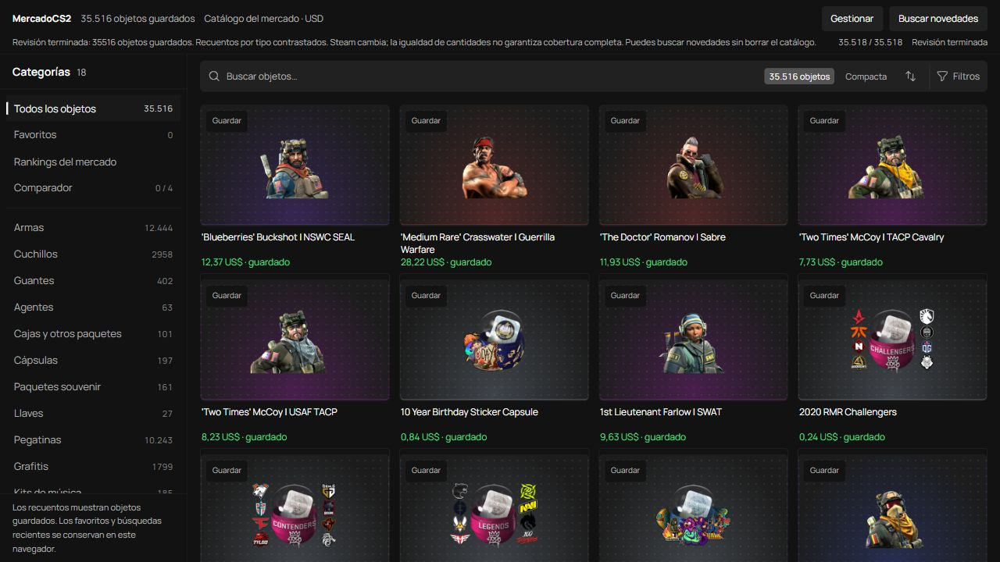
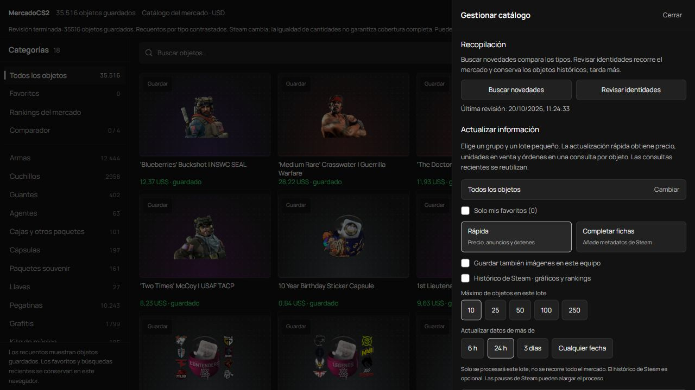

# datos-mercado-cs2

Catálogo del mercado de Counter-Strike 2 en JSON, organizado por categorías. Incluye nombres, imágenes mediante enlaces de Steam, precios en USD, unidades en venta y fechas de consulta.

**35.516 objetos · 17 categorías con datos.**

**Recopilación y organización: Nicolás Única.**

## Cómo se obtienen los datos

He recopilado estos datos con una **herramienta propia que he creado para consultar y organizar el mercado de CS2 en Steam**.

Su funcionamiento es sencillo:

1. Recorre las páginas públicas del mercado de CS2 y reconoce cada objeto por su nombre de mercado, evitando duplicados.
2. Guarda la imagen como enlace, el precio, las unidades anunciadas y sus fechas de consulta.
3. Organiza los objetos por categoría y contrasta recuentos para localizar posibles faltantes.
4. Conserva el progreso y permite actualizar grupos de objetos sin repetir todo el recorrido.

### Funciones de la herramienta

- Catálogo por categorías, con imágenes y precios guardados.
- Búsqueda tolerante a errores y filtros según el tipo de objeto.
- Favoritos y comparación de hasta cuatro objetos.
- Consulta de precios, unidades en venta y órdenes de compra/venta.
- Históricos de ventas de Steam con gráficos de evolución.
- Rankings de subidas, bajadas, precios y cantidad de anuncios.
- Actualizaciones por categorías o favoritos, con tamaño de lote y antigüedad configurables.
- Recopilación reanudable, caché y pausas ante los límites de Steam.
- Exportación JSON/CSV y copias de seguridad locales.

**Tengo previsto publicar la herramienta dentro de unos meses.**

### Catálogo



### Control de la recopilación



Esta versión contiene consultas del **19 y 20 de octubre de 2026**. Cada precio y cantidad conserva su fecha real, expresada en **UTC**.

## Archivos

- **[categorias/](categorias/)**: un archivo JSON por categoría con datos.
- **[indice.json](indice.json)**: categorías, recuentos, rutas y huellas SHA-256.
- **[metadatos.json](metadatos.json)**: fuente, fechas y explicación completa de los campos.

Todos los objetos tienen el mismo formato. Las categorías vacías no generan archivos.

## Datos de cada objeto

| Información | Campos |
| --- | --- |
| Identidad | `id`, `nombre`, `nombre_mercado` |
| Autor de la recopilación | `autor_recopilacion` |
| Clasificación | Categoría, tipo, rareza, exterior, StatTrak y Souvenir |
| Enlaces | `imagen_url`, `steam_url` |
| Precio | `moneda`, `precio_usd`, `precio_centimos`, `tipo_precio` |
| Disponibilidad | `unidades_venta` |
| Fechas | `fecha_precio`, `fecha_unidades_venta`, `fecha_captura` |

Para calcular importes, utiliza `precio_centimos`: **1237 = 12,37 USD**. Un valor `null` indica que el dato no consta o no corresponde.

## Ejemplo de uso

```python
import json

with open("categorias/armas.json", encoding="utf-8") as archivo:
    armas = json.load(archivo)

for objeto in armas[:5]:
    print(objeto["nombre"], objeto["precio_usd"], objeto["fecha_precio"])
```

## A tener en cuenta

- Los precios son los valores anunciados guardados en su fecha, no cotizaciones actuales ni compras personales.
- `unidades_venta` indica unidades anunciadas, no ventas realizadas.
- Las imágenes de los objetos se enlazan desde Steam; no se descargan en este repositorio.
- No se garantiza cobertura del 100 % del mercado ni la verificación individual de todas las clasificaciones.
- Este repositorio contiene los datos; no incluye el programa utilizado para recopilarlos.

## Fuente

[Mercado de CS2 en Steam](https://steamcommunity.com/market/search?appid=730). Las imágenes y marcas pertenecen a sus titulares. Proyecto independiente, sin afiliación con Valve.
